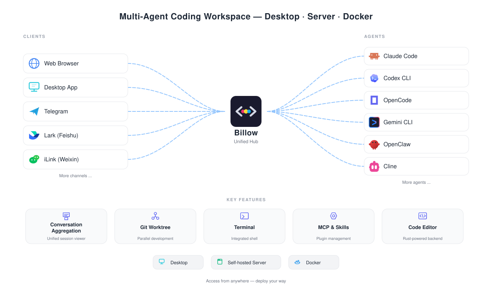

# Billow

[](https://github.com/xintaofei/billow/releases)
[](../../LICENSE)
[](https://tauri.app/)
[](https://nextjs.org/)
[](../../Dockerfile)

<p>
  <a href="../../README.md">English</a> |
  <a href="./README.zh-CN.md">简体中文</a> |
  <a href="./README.zh-TW.md">繁體中文</a> |
  <a href="./README.ja.md">日本語</a> |
  <a href="./README.ko.md">한국어</a> |
  <a href="./README.es.md">Español</a> |
  <a href="./README.de.md">Deutsch</a> |
  <a href="./README.fr.md">Français</a> |
  <a href="./README.pt.md">Português</a> |
  <strong>العربية</strong>
</p>

Billow (Code Generation) هو مساحة عمل للبرمجة متعددة الوكلاء. يجمع عدة وكلاء (Claude Code، Codex CLI، OpenCode، Gemini CLI، OpenClaw، Cline، Hermes Agent، وغيرها) في مساحة عمل واحدة، ويدعم تجميع المحادثات والتعاون بين عدة وكلاء، مع دعم التثبيت على سطح المكتب والنشر على الخادم/Docker.



## الرعاة

<table>
  <tr>
    <td colspan="2" align="center">
      <a href="https://myclaw.ai/?utm_source=github&utm_campaign=billow" target="_blank"></a><br/>
      <strong><a href="https://myclaw.ai/?utm_source=github&utm_campaign=billow">MyClaw.ai</a></strong> — منصة OpenClaw سحابية مُدارة بالكامل: نشر بنقرة واحدة، وتشغيل على مدار الساعة طوال أيام الأسبوع، وملكية كاملة للبيانات — دون الحاجة إلى إدارة أي خادم.
    </td>
  </tr>
  <tr>
    <td align="center" width="220">
      <a href="https://www.compshare.cn/?ytag=GPU_YY_git_billow" target="_blank"></a><br/>
      <strong><a href="https://www.compshare.cn/?ytag=GPU_YY_git_billow">Compshare (UCloud)</a></strong>
    </td>
    <td>شكراً لـ Compshare على رعاية هذا المشروع! Compshare هي منصة الذكاء الاصطناعي السحابية التابعة لشركة UCloud، وتقدّم باقات Plan للوكلاء بنماذج محلية بأسعار اقتصادية شهرياً أو حسب الاستخدام، بدءاً من 49 يوان/شهر. كما توفّر وصولاً مستقراً إلى النماذج الأجنبية عبر وكيل رسمي. تدعم التكامل مع Claude Code وCodex واستدعاءات API. جاهزة للمؤسسات: تزامن عالٍ، ودعم فني على مدار الساعة طوال أيام الأسبوع، وإصدار الفواتير ذاتياً. المستخدمون الذين يسجّلون عبر <a href="https://www.compshare.cn/?ytag=GPU_YY_git_billow">هذا الرابط</a> يحصلون على رصيد تجريبي مجاني بقيمة 5 يوان على المنصة!</td>
  </tr>
</table>

> هل ترغب في أن تصبح راعياً لـ Billow؟ [راسلنا عبر البريد الإلكتروني.](mailto:itpkcn@gmail.com)

## الواجهة الرئيسية


## الإعدادات


## أبرز المزايا

- **تجميع المحادثات** — استيراد جلسات جميع الوكلاء المدعومين إلى مساحة عمل موحّدة
- **التعاون متعدد الوكلاء** — داخل جلسة واحدة، يفوّض الوكيل الرئيسي إلى وكلاء فرعيين من أنواع مختلفة (مثل Claude Code يستدعي Codex وGemini) لإنجاز مهمة بشكل مشترك، مع تشغيل كل وكيل فرعي كجلسة مستقلة
- تطوير متوازي مع تدفقات `git worktree` مدمجة
- **مُنشئ المشروع** — إنشاء مشاريع جديدة بصريًا مع معاينة حية
- **قنوات الدردشة** — ربط Telegram وLark (Feishu) وiLink (Weixin) والمزيد بوكلاء البرمجة لاستقبال الإشعارات الفورية والتفاعل الكامل مع الجلسات والتحكم عن بُعد في المهام
- إدارة MCP (فحص محلي + بحث/تثبيت من السجل)
- إدارة Skills (نطاق عام ونطاق المشروع)
- إدارة حسابات Git البعيدة (GitHub وخوادم Git الأخرى)
- وضع خدمة الويب — الوصول إلى Billow من أي متصفح للعمل عن بُعد
- **نشر خادم مستقل** — شغّل `billow-server` على أي خادم Linux/macOS، والوصول عبر المتصفح
- **دعم Docker** — `docker compose up` أو `docker run`، مع رمز مصادقة ومنفذ قابلين للتخصيص، واستمرارية البيانات وتحميل مجلدات المشاريع
- حلقة هندسية متكاملة (شجرة الملفات، الفروقات، تغييرات git، الإيداع، الطرفية)

## الوكلاء المدعومون

| الوكيل       | مسار متغير البيئة                     | الافتراضي في macOS / Linux            | الافتراضي في Windows                                  |
| ------------ | ------------------------------------- | ------------------------------------- | ----------------------------------------------------- |
| Claude Code  | `$CLAUDE_CONFIG_DIR/projects`         | `~/.claude/projects`                  | `%USERPROFILE%\\.claude\\projects`                    |
| Codex CLI    | `$CODEX_HOME/sessions`                | `~/.codex/sessions`                   | `%USERPROFILE%\\.codex\\sessions`                     |
| OpenCode     | `$XDG_DATA_HOME/opencode/opencode.db` | `~/.local/share/opencode/opencode.db` | `%USERPROFILE%\\.local\\share\\opencode\\opencode.db` |
| Gemini CLI   | `$GEMINI_CLI_HOME/.gemini`            | `~/.gemini`                           | `%USERPROFILE%\\.gemini`                              |
| OpenClaw     | —                                     | `~/.openclaw/agents`                  | `%USERPROFILE%\\.openclaw\\agents`                    |
| Cline        | `$CLINE_DIR`                          | `~/.cline/data/tasks`                 | `%USERPROFILE%\\.cline\\data\\tasks`                  |
| Hermes Agent | `$HERMES_HOME/state.db`               | `~/.hermes/state.db`                  | `%USERPROFILE%\\.hermes\\state.db`                    |

> ملاحظة: متغيرات البيئة لها الأولوية على المسارات الافتراضية.

<details>
<summary><h2>مُنشئ المشروع</h2></summary>

أنشئ مشاريع جديدة بصريًا من خلال واجهة مقسّمة: التكوين على اليسار، والمعاينة الحية على اليمين.


### الميزات

- **تكوين بصري** — اختر النمط وسمة الألوان ومكتبة الأيقونات والخط ونصف قطر الحدود والمزيد من القوائم المنسدلة؛ تتحدث المعاينة فورًا
- **معاينة حية** — شاهد المظهر الذي اخترته مُصيَّرًا في الوقت الفعلي قبل إنشاء أي شيء
- **إنشاء بنقرة واحدة** — اضغط "إنشاء مشروع" ويقوم المُشغّل بتنفيذ `shadcn init` مع إعداداتك المسبقة وقالب الإطار (Next.js / Vite / React Router / Astro / Laravel) ومدير الحزم (pnpm / npm / yarn / bun)
- **اكتشاف مدير الحزم** — يتحقق تلقائيًا من مديري الحزم المثبتين ويعرض إصداراتهم
- **تكامل سلس** — يُفتح المشروع المُنشأ حديثًا مباشرة في مساحة عمل Billow

يدعم حاليًا إنشاء مشاريع **shadcn/ui**، مع تصميم قائم على علامات التبويب جاهز لدعم المزيد من أنواع المشاريع في المستقبل.

</details>

<details>
<summary><h2>قنوات الدردشة</h2></summary>

اربط تطبيقات المراسلة المفضلة لديك — Telegram وLark (Feishu) وiLink (Weixin) والمزيد — بوكلاء البرمجة بالذكاء الاصطناعي. أنشئ مهامًا، وأرسل رسائل متابعة، ووافق على الأذونات، واستأنف الجلسات، وراقب النشاط من تطبيق الدردشة — واستقبل ردود الوكلاء الفورية مع تفاصيل استدعاءات الأدوات وطلبات الأذونات وملخصات الإنجاز دون الحاجة لفتح المتصفح.

### القنوات المدعومة

| القناة         | البروتوكول                  | الحالة |
| -------------- | --------------------------- | ------ |
| Telegram       | Bot API (HTTP long-polling) | مدمج   |
| Lark (Feishu)  | WebSocket + REST API        | مدمج   |
| iLink (Weixin) | WebSocket + REST API        | مدمج   |

> يُخطَّط لدعم المزيد من القنوات (Discord وSlack وDingTalk وغيرها) في الإصدارات المستقبلية.

</details>

<details>
<summary><h2>البدء السريع</h2></summary>

### المتطلبات

- Node.js `>=22` (مُوصى به)
- pnpm `>=10`
- Rust stable (2021 edition)
- تبعيات بناء Tauri 2 (وضع سطح المكتب فقط)

مثال على Linux (Debian/Ubuntu):

```bash
sudo apt-get update
sudo apt-get install -y \
  libwebkit2gtk-4.1-dev \
  libayatana-appindicator3-dev \
  librsvg2-dev \
  patchelf
```

### الملفات التنفيذية

يوفّر Billow ثلاثة ملفات تنفيذية بلغة Rust من workspace واحد:

| الملف التنفيذي | الدور                                                                                                                  | البناء                                                                       |
| -------------- | ---------------------------------------------------------------------------------------------------------------------- | ---------------------------------------------------------------------------- |
| `billow`        | تطبيق سطح المكتب Tauri (نافذة، شريط النظام، المُحدِّث)                                                                 | `pnpm tauri build` (إصدار) / `pnpm tauri dev` (تطوير)                        |
| `billow-server` | خادم HTTP + WebSocket مستقل لعمليات النشر عبر المتصفح/بدون واجهة                                                       | `pnpm server:build` / `pnpm server:dev`                                      |
| `billow-mcp`    | رفيق MCP عبر stdio يُشغَّل لكل جلسة، ويُتيح أداة `delegate_to_agent` لواجهات CLI للوكلاء (التعاون متعدد الوكلاء)        | `pnpm tauri:prepare-sidecars` (يُستدعى تلقائيًا من `tauri dev` / `tauri build`) |

يجب أن يكون `billow-mcp` بجوار ملفه التنفيذي الأصلي وقت التشغيل — برامج التثبيت وصورة Docker ومُجمِّع sidecar الخاص بـ Tauri جميعها تضعه بجوار `billow` / `billow-server`. يمكن لعمليات البناء من المصدر والتخطيطات المخصّصة تجاوز البحث باستخدام متغير البيئة `BILLOW_MCP_BIN=/مسار/مطلق/billow-mcp`. في حال غياب الرفيق، يتم تخطّي التفويض (مع تسجيل تحذير واحد) وتستمر باقي جلسة الوكيل في العمل.

### التطوير

```bash
pnpm install

# الواجهة الأمامية فقط (خادم تطوير Next.js، بدون Rust)
pnpm dev

# تصدير ثابت للواجهة الأمامية إلى out/
pnpm build

# تطبيق سطح المكتب الكامل (Tauri + Next.js، يبني sidecar الخاص بـ billow-mcp تلقائيًا)
pnpm tauri dev

# بناء إصدار سطح المكتب (يُضمِّن billow-mcp بوصفه externalBin)
pnpm tauri build

# خادم مستقل (بدون Tauri/واجهة رسومية)
pnpm server:dev
pnpm server:build                  # ملف الإصدار التنفيذي ضمن src-tauri/target/release/billow-server

# بناء رفيق billow-mcp بشكل صريح (لثلاثية المضيف)
pnpm tauri:prepare-sidecars        # الناتج: src-tauri/binaries/billow-mcp-<triple>

# تخطّي تحضير sidecar عند التكرار على الواجهة الأمامية ولا تحتاج إلى التفويض
BILLOW_SKIP_SIDECAR=1 pnpm tauri dev

# فحص الأكواد
pnpm eslint .

# اختبارات الواجهة الأمامية (vitest)
pnpm test
pnpm test:watch
pnpm test:coverage

# فحوصات Rust (تنفيذ في src-tauri/)
cargo check                                                     # سطح المكتب (الميزات الافتراضية)
cargo check --no-default-features --bin billow-server            # وضع الخادم
cargo check --no-default-features --bin billow-mcp               # رفيق MCP
cargo clippy --all-targets --features test-utils -- -D warnings

# اختبارات Rust
cargo test --features test-utils                                # سطح المكتب (يشمل التكامل)
cargo test --no-default-features --bin billow-server --lib       # وضع الخادم
cargo insta review                                              # قبول تحديثات لقطات المُحلِّل
```

> نصيحة: عند توفّر بناء جديد لـ `billow-mcp` ضمن `src-tauri/target/release/` وأردت توجيه `billow-server` مُشغَّل يدويًا إليه دون إعادة التثبيت، صدِّر `BILLOW_MCP_BIN=$(pwd)/src-tauri/target/release/billow-mcp`.

### نشر الخادم

يمكن تشغيل Billow كخادم ويب مستقل بدون بيئة سطح مكتب.

#### الخيار 1: التثبيت بسطر واحد (Linux / macOS)

```bash
curl -fsSL https://raw.githubusercontent.com/xintaofei/billow/main/install.sh | bash
```

تثبيت إصدار محدد أو في دليل مخصص:

```bash
curl -fsSL https://raw.githubusercontent.com/xintaofei/billow/main/install.sh | bash -s -- --version v0.5.2 --dir ~/.local/bin
```

ثم التشغيل:

```bash
billow-server
```

#### الخيار 2: التثبيت بسطر واحد (Windows PowerShell)

```powershell
irm https://raw.githubusercontent.com/xintaofei/billow/main/install.ps1 | iex
```

أو تثبيت إصدار محدد:

```powershell
.\install.ps1 -Version v0.5.2
```

#### الخيار 3: التنزيل من GitHub Releases

الملفات التنفيذية المُعدّة مسبقًا (مع موارد الويب المضمّنة) متاحة في صفحة [Releases](https://github.com/xintaofei/billow/releases):

| المنصة      | الملف                              |
| ----------- | ---------------------------------- |
| Linux x64   | `billow-server-linux-x64.tar.gz`    |
| Linux arm64 | `billow-server-linux-arm64.tar.gz`  |
| macOS x64   | `billow-server-darwin-x64.tar.gz`   |
| macOS arm64 | `billow-server-darwin-arm64.tar.gz` |
| Windows x64 | `billow-server-windows-x64.zip`     |

```bash
# مثال: التنزيل والاستخراج والتشغيل
tar xzf billow-server-linux-x64.tar.gz
cd billow-server-linux-x64
BILLOW_STATIC_DIR=./web ./billow-server
```

#### الخيار 4: Docker

```bash
# باستخدام Docker Compose (مُوصى به)
docker compose up -d

# أو التشغيل مباشرة باستخدام Docker
docker run -d -p 3080:3080 -v billow-data:/data ghcr.io/xintaofei/billow:latest

# مع رمز مصادقة مخصص وتحميل مجلد المشروع
docker run -d -p 3080:3080 \
  -v billow-data:/data \
  -v /path/to/projects:/projects \
  -e BILLOW_TOKEN=your-secret-token \
  ghcr.io/xintaofei/billow:latest
```

تستخدم صورة Docker بناءً متعدد المراحل (Node.js + Rust → بيئة تشغيل Debian خفيفة) وتتضمن `git` و`ssh` لعمليات المستودعات. يتم تخزين البيانات بشكل دائم في وحدة التخزين `/data`. يمكنك اختياريًا تحميل مجلدات المشاريع للوصول إلى المستودعات المحلية من داخل الحاوية.

#### الخيار 5: البناء من المصدر

```bash
pnpm install && pnpm build          # بناء الواجهة الأمامية
cd src-tauri
cargo build --release --bin billow-server --no-default-features
cargo build --release --bin billow-mcp --no-default-features    # رفيق التفويض
BILLOW_STATIC_DIR=../out ./target/release/billow-server          # يتم التقاط billow-mcp بوصفه ملفًا شقيقًا
```

إذا احتفظت بالملفين التنفيذيين في دليلين منفصلين، فاضبط `BILLOW_MCP_BIN=/مسار/مطلق/إلى/billow-mcp` حتى يستطيع التشغيل العثور على الرفيق؛ بدون ذلك، يُعطَّل التفويض متعدد الوكلاء بصمت.

#### التكوين

متغيرات البيئة:

| المتغير                        | الافتراضي              | الوصف                                                                                                                                                                                                                                                                                                                                                                                                       |
| ------------------------------ | ---------------------- | ----------------------------------------------------------------------------------------------------------------------------------------------------------------------------------------------------------------------------------------------------------------------------------------------------------------------------------------------------------------------------------------------------------- |
| `BILLOW_PORT`                   | `3080`                 | منفذ HTTP                                                                                                                                                                                                                                                                                                                                                                                                   |
| `BILLOW_HOST`                   | `0.0.0.0`              | عنوان الربط                                                                                                                                                                                                                                                                                                                                                                                                 |
| `BILLOW_TOKEN`                  | _(عشوائي)_             | رمز المصادقة (يُطبع في stderr عند البدء)                                                                                                                                                                                                                                                                                                                                                                    |
| `BILLOW_DATA_DIR`               | `~/.local/share/billow` | دليل قاعدة بيانات SQLite (والجذر أيضاً لـ `uploads/` و `pets/`)                                                                                                                                                                                                                                                                                                                                             |
| `BILLOW_STATIC_DIR`             | `./web` أو `./out`     | دليل التصدير الثابت لـ Next.js                                                                                                                                                                                                                                                                                                                                                                              |
| `BILLOW_MCP_BIN`                | _(غير مُحدّد)_         | المسار المطلق لرفيق `billow-mcp`. يتجاوز البحث الافتراضي (ملف شقيق للملف التنفيذي + `PATH`). استخدمه لعمليات البناء من المصدر أو التخطيطات المخصّصة التي يقع فيها الرفيق خارج دليل تثبيت الخادم.                                                                                                                                                                                                            |
| `BILLOW_SKIP_SIDECAR`           | _(غير مُحدّد)_         | متغير راحة للواجهة الأمامية فقط لـ `pnpm tauri dev` / `pnpm tauri build` — عند `1` يتم تخطّي بناء sidecar الخاص بـ `billow-mcp`. يُعطَّل التفويض في هذا البناء؛ ويجب ترك المتغير غير مُحدَّد للقطع الصالحة للشحن.                                                                                                                                                                                            |
| `BILLOW_UPLOAD_MAX_TOTAL_BYTES` | _(غير مُحدّد)_         | حدّ صارم لإجمالي البايتات المقيمة تحت `<data dir>/uploads/`. عدد بايتات عشري (مثلاً `10737418240` لـ 10 GiB). إذا كان غير مُحدّد أو `0` أو قيمة لا يمكن تحليلها فسيتم تعطيل الحدّ وطباعة سطر عند البدء حتى تكون الحالة مرئية. يُطبَّق الحدّ داخل عملية `billow-server` واحدة — تحتاج عمليات النشر الموسَّعة أفقياً التي تتشارك حجم `uploads/` واحداً إلى تنسيق خارجي (قفل ملف، Redis، حصّة عبر بروكسي عكسي). |
| `BILLOW_UPLOAD_QUOTA_STRICT`    | _(غير مُحدّد)_         | عند كونه صحيحاً (`1` / `true` / `yes` / `on`)، يُلغي البدء برمز خروج 2 إذا كانت `BILLOW_UPLOAD_MAX_TOTAL_BYTES` مضبوطة على قيمة لا يمكن تحليلها، بدلاً من المتابعة مع تحذير WARN. استخدم هذا حين تتطلب سياستك الأمنية أن «تكون الحصّة المُعدَّة فعّالة».                                                                                                                                                     |

</details>

<details>
<summary><h2>الهندسة المعمارية</h2></summary>

```text
Next.js 16 (Static Export) + React 19
        |
        | invoke() (desktop) / fetch() + WebSocket (web)
        v
  ┌─────────────────────────┐
  │   Transport Abstraction  │
  │  (Tauri IPC or HTTP/WS) │
  └─────────────────────────┘
        |
        v
┌─── Tauri Desktop ───┐    ┌─── billow-server ───┐
│  Tauri 2 Commands    │    │  Axum HTTP + WS    │
│  (window management) │    │  (standalone mode)  │
└──────────┬───────────┘    └──────────┬──────────┘
           └──────────┬───────────────┘
                      v
            Shared Rust Core
              |- AppState
              |- ACP Manager
              |- Parsers (conversation ingestion)
              |- Chat Channels
              |- Git / File Tree / Terminal
              |- MCP marketplace + config
              |- SeaORM + SQLite
                      |
              ┌───────┼───────┐
              v       v       v
  Local Filesystem  Git   Chat Channels
    / Git Repos    Repos  (Telegram, Lark, iLink)
```

</details>

## الخصوصية والأمان

- محلي أولاً بشكل افتراضي للتحليل والتخزين وعمليات المشروع
- الوصول إلى الشبكة يحدث فقط عند الإجراءات التي يبدأها المستخدم
- دعم بروكسي النظام لبيئات المؤسسات
- وضع خدمة الويب يستخدم مصادقة قائمة على الرموز

## المجتمع

- امسح رمز QR أدناه للانضمام إلى مجموعة WeChat الخاصة بنا للنقاشات والملاحظات والتحديثات


- شكراً لمجتمع [LinuxDO](https://linux.do) على دعمه

## شكر وتقدير

- [ACP](https://agentclientprotocol.com) — بروتوكول Agent Client (ACP) هو الأساس الذي يمكّن Billow من الاتصال بعدة وكلاء

## الترخيص

Apache-2.0. راجع `LICENSE`.
